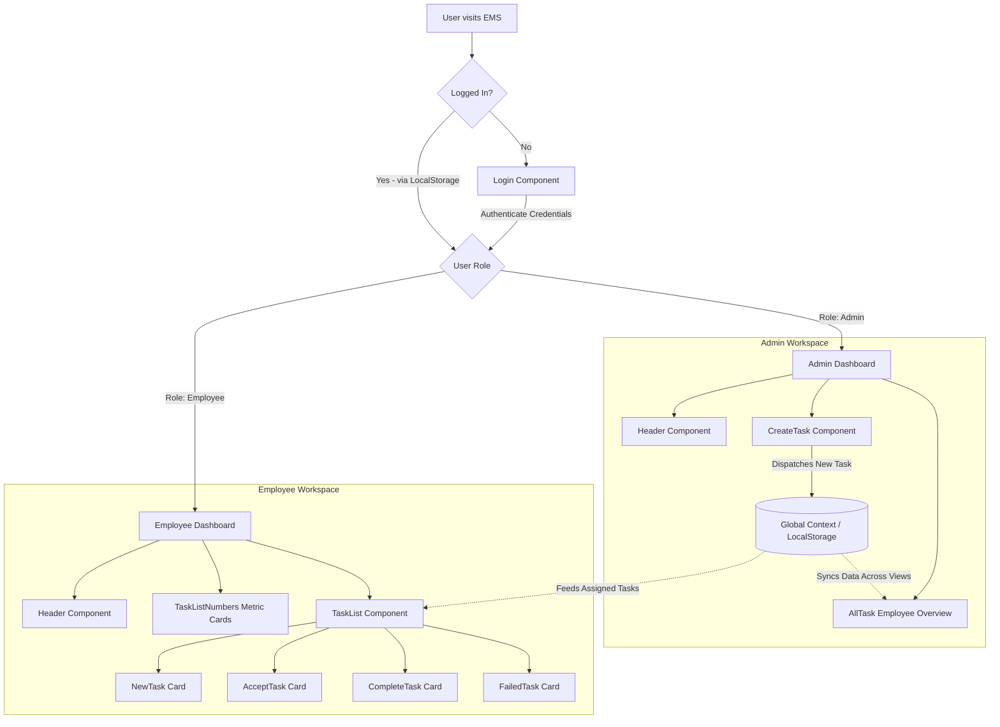

<div align="center">

# ⚡ Employee Management System (EMS)

> A modern, role-based Task & Workforce Management Web Application built with **React 18**, **Tailwind CSS**, and **Vite**.

[](https://reactjs.org/)
[](https://vitejs.dev/)
[](https://tailwindcss.com/)
[](https://suryat8957.github.io/Employee-Management-System/)
[](https://opensource.org/licenses/MIT)

**[🌐 View Live Demo](https://suryat8957.github.io/Employee-Management-System/)**

<p align="center">
  <a href="#-key-features">Features</a> •
  <a href="#-demo-credentials">Demo Credentials</a> •
  <a href="#-quick-start">Quick Start</a> •
  <a href="#-deployment-to-github-pages">Deploy to GitHub Pages</a> •
  <a href="#%EF%B8%8F-system-architecture">Architecture</a> •
  <a href="#-project-structure">Folder Structure</a> •
  <a href="#-roadmap">Roadmap</a>
</p>

---

</div>

## 📌 Overview

**EMS (Employee Management System)** is a responsive, high-performance web dashboard that bridges communication between team administrators and employees. It streamlines day-to-day workflow tracking by allowing administrators to assign tasks with categories, due dates, and priority descriptions, while giving employees a dedicated portal to view, accept, complete, or flag assigned tasks in real time.

Built on top of **React Context API** and browser **LocalStorage**, EMS provides a full-featured, zero-backend-dependency experience that persists state smoothly across sessions.

---

## ✨ Key Features

### 🛡️ 1. Role-Based Access Control (RBAC)
- **Distinct Authentication Flow:** Dedicated routing and views based on authenticated identity (`admin` vs. `employee`).
- **Persistent Session State:** Automatically preserves logged-in sessions via LocalStorage so refreshes keep you in context.

### 👔 2. Administrator Dashboard
- **Task Creation Studio:** Quick-form interface to compose and assign tasks with custom title, due date, category tag, assignee, and detailed specifications.
- **Global Employee Monitor (`AllTask`):** Real-time summary grid tracking task metrics for every employee across 4 key dimensions:
  - 🆕 *New Tasks*
  - ⚡ *Active / In-Progress Tasks*
  - ✅ *Completed Tasks*
  - ❌ *Failed Tasks*
- **Dynamic Employee Sync:** Newly created tasks automatically update state and re-calculate task counters for the assigned team member.

### 👷 3. Employee Dashboard
- **Personalized Header & Welcome Banner:** Tailored interface with one-click logout.
- **Visual Metric Counters:** Bold status indicators highlighting workload distribution at a glance.
- **Interactive Task Board:** Horizontal scrollable task feed split into distinct lifecycle states:
  - **New Tasks:** Freshly assigned assignments waiting to be accepted.
  - **Active Tasks:** In-progress work with actions to **Mark as Completed** or **Mark as Failed**.
  - **Completed Tasks:** Archived list of successfully finalized tasks.
  - **Failed Tasks:** Historical log of blocked or incomplete assignments.

---

## 🔑 Demo Credentials

EMS comes pre-loaded with sample accounts ready for immediate testing:

### 👑 Admin Portal
| Role | Email | Password | Access Level |
| :--- | :--- | :--- | :--- |
| **Administrator** | `admin@me.com` | `123` | Full administrative control & task assignment |

### 👥 Employee Accounts
| Employee Name | Email | Password | Primary Domain |
| :--- | :--- | :--- | :--- |
| **Arjun** | `e@e.com` | `123` | Design & Development |
| **Sneha** | `employee2@example.com` | `123` | Database & UI Design |
| **Ravi** | `employee3@example.com` | `123` | QA & Development |
| **Priya** | `employee4@example.com` | `123` | DevOps & Technical Docs |
| **Karan** | `employee5@example.com` | `123` | Support & Production Deployments |

---

## 🏗️ System Architecture



---

## 💻 Tech Stack

| Layer | Technology | Description |
| :--- | :--- | :--- |
| **Framework** | [React 18](https://react.dev/) | Declarative component-driven UI architecture |
| **Bundler & Tooling** | [Vite 5](https://vitejs.dev/) | Next-generation frontend tooling with instant HMR |
| **Styling** | [Tailwind CSS 3](https://tailwindcss.com/) | Modern utility-first CSS framework |
| **State Management** | React Context API | Centralized authentication and reactive task store |
| **Data Persistence** | Browser LocalStorage | Seamless offline state and seed data persistence |
| **Code Quality** | ESLint + PostCSS | Automated linting and CSS post-processing pipeline |

---

## 📁 Project Structure

```text
ems/
├── public/                 # Static assets and icons
│   └── vite.svg
├── src/
│   ├── assets/             # Brand graphics and multimedia assets
│   ├── components/
│   │   ├── Auth/           # Authentication modules
│   │   │   └── Login.jsx   # Dual-role credential verification
│   │   ├── Dashboard/      # Top-level view controllers
│   │   │   ├── AdminDashboard.jsx
│   │   │   └── EmployeeDashboard.jsx
│   │   ├── TaskList/       # Task lifecycle UI cards
│   │   │   ├── AcceptTask.jsx
│   │   │   ├── CompleteTask.jsx
│   │   │   ├── FailedTask.jsx
│   │   │   ├── NewTask.jsx
│   │   │   └── TaskList.jsx
│   │   └── other/          # Shared layout and reporting widgets
│   │       ├── AllTask.jsx
│   │       ├── CreateTask.jsx
│   │       ├── Header.jsx
│   │       └── TaskListNumbers.jsx
│   ├── context/
│   │   └── AuthProvider.jsx # Global user & task state provider
│   ├── utils/
│   │   └── localStorage.jsx # Seed datasets & persistence utilities
│   ├── App.css             # Component-level animations & styles
│   ├── App.jsx             # Root layout controller & role router
│   ├── index.css           # Tailwind design tokens & base directives
│   └── main.jsx            # Application entry point
├── .eslintrc.cjs           # Linting configurations
├── index.html              # HTML shell
├── package.json            # Scripts & project dependencies
├── postcss.config.js       # PostCSS plugins (Tailwind, Autoprefixer)
├── tailwind.config.js      # Tailwind CSS customizations
└── vite.config.js          # Vite build parameters
```

---

## 🚀 Quick Start

Follow these steps to get a local copy running on your machine:

### Prerequisites
Make sure you have [Node.js](https://nodejs.org/) installed on your machine (`v16.0.0` or higher recommended).

```bash
# Verify your Node and npm versions
node -v
npm -v
```

### Installation

1. **Clone the repository:**
   ```bash
   git clone https://github.com/suryat8957/Employee-Management-System.git
   ```

2. **Navigate to the project root:**
   ```bash
   cd Employee-Management-System
   ```

3. **Install dependencies:**
   ```bash
   npm install
   ```

4. **Start the local development server:**
   ```bash
   npm run dev
   ```

5. **Open in your browser:**
   Open [http://localhost:5173](http://localhost:5173) in your favorite browser.

---

## 🌐 Deployment to GitHub Pages

This project is pre-configured for seamless deployment to **GitHub Pages**. You can deploy using either of two methods:

### Method 1: Automatic Deployment via GitHub Actions (Recommended)
A ready-to-use CI/CD workflow is located in `.github/workflows/deploy.yml`.

1. Commit and push your code to GitHub:
   ```bash
   git add .
   git commit -m "feat: setup project for GitHub Pages"
   git push origin main
   ```
2. On GitHub, navigate to your repository:
   - Go to **Settings** > **Pages**
   - Under **Build and deployment** > **Source**, select **GitHub Actions**
3. That's it! GitHub will automatically build and publish your site to:
   `https://suryat8957.github.io/Employee-Management-System/`

### Method 2: Manual Deployment via `gh-pages` Script
If you prefer deploying directly from your terminal:

```bash
npm run deploy
```
*This command automatically triggers `npm run build` and publishes the production `dist/` directory directly to your repository's `gh-pages` branch.*

---

## 📜 Available Scripts

In the project directory, you can run:

| Command | Action |
| :--- | :--- |
| `npm run dev` | Starts the Vite development server with Hot Module Replacement (HMR). |
| `npm run build` | Compiles and optimizes assets into the `dist/` directory for production with relative base paths. |
| `npm run preview`| Locally previews the production build before deployment. |
| `npm run deploy` | Builds the project and deploys the `dist/` folder to GitHub Pages via `gh-pages`. |
| `npm run lint` | Runs ESLint to identify code smells and enforce coding standards. |

---

## 🧭 Roadmap & Future Enhancements

- [ ] **Full Backend Integration:** Migrate LocalStorage to a Node.js / Express or Next.js API with MongoDB or PostgreSQL.
- [ ] **JWT Authentication:** Add password hashing (bcrypt) and secure token-based authorization.
- [ ] **Task Deadlines & Notifications:** Push alerts and countdown warnings for upcoming due dates.
- [ ] **Category Filters & Search:** Search bar to filter tasks by title, category, or status.
- [ ] **Employee Profile Customization:** Allow staff to upload avatars and update profile details.
- [ ] **Analytics Dashboard:** Graphical charts (e.g., Chart.js / Recharts) visualizing completion rates over time.

---

## 🤝 Contributing

Contributions are what make the open-source community such an amazing place to learn, inspire, and create. Any contributions you make are **greatly appreciated**!

1. Fork the Project
2. Create your Feature Branch (`git checkout -b feature/AmazingFeature`)
3. Commit your Changes (`git commit -m 'feat: Add some AmazingFeature'`)
4. Push to the Branch (`git push origin feature/AmazingFeature`)
5. Open a Pull Request

---

## 📄 License

Distributed under the **MIT License**. See `LICENSE` for more information.

---

<div align="center">
  <sub>Engineered with care for better productivity and workforce collaboration.</sub>
</div>
